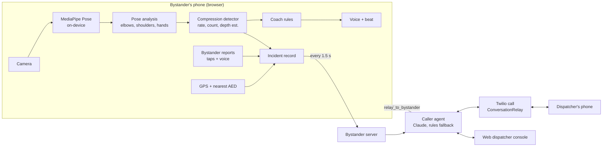

# Bystander

**A live CPR coach, and an AI that calls for help at the same time.**

Bystander turns one phone into two agents. While the camera coaches the bystander through chest compressions ("faster… good… lock your elbows"), a voice agent phones the dispatcher. It reads out the address, how long CPR has been going, the compression count and rate, and anything the bystander reports, and it answers the dispatcher's questions. The session ends on a scorecard measured against American Heart Association targets.

It is a **training and assist prototype**. It only ever calls the demo number set on the server, never 911.

---

## What it does

| | |
|---|---|
| **Coach** | The phone camera watches the rescuer from the side. MediaPipe pose tracking runs on the phone and measures the **compression rate and count**, whether the **elbows are locked**, whether the **shoulders are over the hands**, and, if you tap the chest center once, whether the **hands stay on it**. A calm voice and a 110-per-minute beat coach in real time. Every two minutes it prompts a rescuer swap. |
| **Caller** | At the same moment, a voice agent calls the dispatcher. It opens with a briefing built from live data, answers questions (Claude, streaming), passes the dispatcher's instructions to the bystander's screen and speaker, and speaks new reports as they happen ("Update from the scene: an AED has arrived"). |
| **Scorecard** | Average rate, share of compressions at the right speed, hands-on time (compression fraction), longest pause, elbow and shoulder form, and estimated depth, each against its target. |
| **Train now** | The same coach without the call, in 30-second to 2-minute rounds on a pillow. This is the answer to "would anyone use this before an emergency?" |
| **Other emergencies** | Step-by-step voice guides for **choking**, **severe bleeding**, and **opioid overdose** (with a second-dose naloxone timer). The caller works in these too, and any guide can switch into the CPR coach. |
| **Nearest AED / pharmacy** | Looks up the nearest *mapped* AED (and pharmacies for overdoses) from OpenStreetMap, and the caller can tell the dispatcher where it is. |

### What is measured, estimated, or left out

| | |
|---|---|
| Compression rate and count | **Measured** from the hands' up-and-down motion. Frame-rate independent, tested from 12 to 60 fps. |
| Elbows, shoulders over hands | **Measured** from a side view. From the front, foreshortening makes these unreliable, so the coach stays quiet about them. |
| Hand position | **Measured** against the chest point you tap. Without a tap the app checks only that the hands are stacked under the shoulders. |
| Compression depth | **Estimated.** One camera cannot measure depth exactly. The app uses the rescuer's arm as a ruler, labels the result "est.", and leaves it out of the grade. |
| Heart rate from the camera | **Left out on purpose.** A person in cardiac arrest has no pulse, and compressions would wreck the signal anyway. |
| Calls to 911 | **Never.** The number comes only from server config. It must be a full international number, and short codes like 911, 112, 999, and 000 are refused even if configured. |

## Try it

Requires Node.js 18 or later.

```bash
cd bystander
npm install
npm run fetch-model     # optional: pose model for offline use (5.8 MB)
npm start               # http://localhost:3000
```

The server prints a **dispatcher console** link (`/dispatch.html#key=…`). Open it on a teammate's laptop or phone and press **Go on duty**. When there is no phone line, emergency calls ring there, and the console speaks the AI's lines aloud and takes questions by voice or text.

- **No camera?** Open `http://localhost:3000/?sim`, or turn on *Simulated rescuer* in Settings. A synthetic rescuer drives the same pipeline. Use the on-screen buttons or the keyboard (↑/↓ rate, `E` bend elbows, `P` pause) to trigger each coaching cue.
- **Use a real phone.** Browsers allow the camera only over HTTPS, so expose the server with a tunnel such as `cloudflared tunnel --url http://localhost:3000` or `ngrok http 3000`, and open that URL on the phone.

### Turn on Claude

```bash
ANTHROPIC_API_KEY=sk-ant-... npm start
```

The caller then answers with Claude (`claude-opus-5-5` by default, effort `low` to keep voice latency down). Server-side refusal fallbacks are enabled. Without a key, or if Claude is slow or fails mid-call, built-in rules answer the common dispatcher questions (address, breathing, how long, compressions, AED, callback, "who is this?") and turn "tell them…" or "ask them…" into messages for the bystander.

### Turn on real phone calls (Twilio)

```bash
TWILIO_ACCOUNT_SID=AC... \
TWILIO_AUTH_TOKEN=... \
TWILIO_FROM_NUMBER=+1415... \
BYSTANDER_DISPATCH_NUMBER=+1650...   # the teammate playing dispatcher
PUBLIC_URL=https://your-tunnel.example \
npm start
```

- **Voice mode `relay`** (the default) uses Twilio **ConversationRelay**. Twilio turns the dispatcher's speech into text over a WebSocket, Claude's answer streams back token by token, and the dispatcher can interrupt. Your Twilio account must have ConversationRelay enabled; Twilio asks you to accept its AI features terms in the Console first.
- **Voice mode `gather`** (`BYSTANDER_VOICE_MODE=gather`) uses classic `<Say>` and `<Gather input="speech">` turns. It is slower but works on any account.
- On a Twilio **trial** account, you can only call verified numbers, and the callee hears a trial notice and must press a key before the call connects.
- Every webhook is checked against Twilio's signature, plus a per-call secret in the URL. If signatures fail behind a tunnel, make sure `PUBLIC_URL` is exactly the public address.

All settings are listed in [`.env.example`](.env.example).

## How it works



**Compression detection** ([`compressions.js`](public/js/core/compressions.js)). Each frame gives the hands' height and the arm's length in pixels. Dividing one by the other makes the signal independent of camera distance. A light low-pass filter removes landmark jitter, and a peak detector with hysteresis marks each bottom (one compression). The hysteresis adapts to the rescuer's own stroke. Rate is 60 divided by the median of the last six intervals, and a gap over 2 seconds counts as a pause. Depth uses a typical adult arm (58 cm) as the ruler and undoes the filter's known shrinkage at the current rate.

**Coaching** ([`coach.js`](public/js/core/coach.js)). A correction is spoken only after the problem has lasted 1.5 to 3 seconds. Lines are at least 2.5 seconds apart, the same line repeats at most every 6 seconds, and praise comes only when nothing is wrong. The priority order is: rescuer out of frame, then stopped, then rate, then elbows, then shoulders, then hands, then depth.

**The caller** ([`caller.js`](lib/caller.js), [`server.js`](server.js)). The opening briefing is built from a template, so the address and numbers are read exactly as recorded. For each question from the dispatcher, Claude gets a fresh fact sheet of the incident plus the recent transcript, and streams a one- or two-sentence spoken answer. The system prompt allows only facts from the record. When the dispatcher wants the bystander told something, Claude calls the `relay_to_bystander` tool, and the message appears and is spoken on the phone. New reports from the bystander are queued and spoken between answers.

**Privacy.** Video never leaves the phone; pose tracking runs in the browser. The server receives only the incident record: location, counts, rates, and reports. Sessions live in memory and expire after 3 hours.

## Tests

```bash
npm test    # 64 tests
```

They cover pose geometry, compression counting at 80 to 140 per minute and 12 to 60 fps, depth estimates, pause handling, coaching cue timing, the scorecard, briefings and fact sheets, rule-based answers, phone-number safety, OpenStreetMap parsing, the Claude caller (streaming, relay tool, truncation, refusal, and error fallback, using a stand-in client), and the server end to end. The end-to-end tests run a web console call from ring to hang-up, a Twilio call with signed webhooks and a live ConversationRelay WebSocket, gather mode, and refusal of a configured 911.

## Project layout

```
public/
  index.html, styles.css      phone app (coach, guides, scorecard, caller panel)
  dispatch.html               web dispatcher console
  js/core/                    shared logic, no DOM (also used by the server and tests)
    pose.js                   landmark geometry and form checks
    compressions.js           compression detector and AHA targets
    coach.js                  what to say and when
    scorecard.js              scoring against AHA targets
    incident.js               incident record, briefing, fact sheet
    scenarios.js              choking, bleeding, overdose steps; report types
    places.js                 nearest AED / pharmacy from OpenStreetMap
    sim.js                    simulated rescuer
  js/ui/                      camera + MediaPipe, overlay, voice + beat, server link
  js/app.js, js/dispatch.js   the two pages
lib/
  caller.js                   Claude caller agent (streaming + relay tool)
  answers.js                  rule-based fallback answers
  twilio.js                   REST calls, signatures, TwiML
  phone.js                    never-dial-emergency-numbers check
  sessions.js                 sessions and live event streams
server.js                     HTTP server, API, Twilio webhooks, ConversationRelay socket
docs/PITCH.md                 60-second demo script, backups, judge Q&A
```

## Medical content

The steps follow published lay-rescuer guidance: American Heart Association CPR and first aid guidelines, American Red Cross first aid steps, the Stop the Bleed program, and SAMHSA's opioid overdose toolkit with naloxone nasal spray instructions. Have a clinician review the steps before any use beyond a demo.
